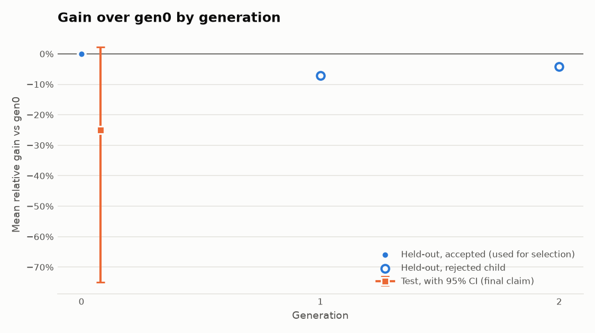
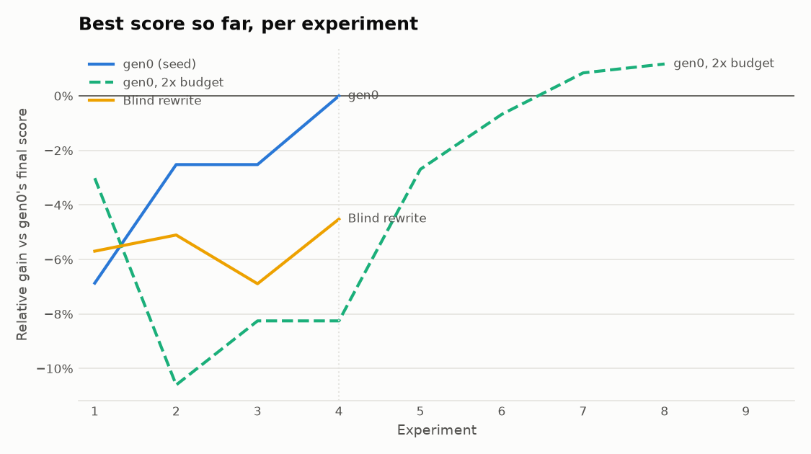

# Prompt-only RSI loop, first valid run

Run `20261117-164852`

First run with harness-side scoring on hidden labels (after four aborted runs, see Findings from earlier runs in the top-level README). The improver is gen0 = Tumble's original prompt; each child rewrites the research and meta prompts from its parent's run evidence. Budget 4 experiments per session, at most 2 generations, 2 repeats in the final evaluation. DeepSeek-V3.1 via W&B Inference.

## Setup

- Harness commit: `6cf9de2`
- Model: None / None
- Budget: 4 experiments per session · max generations: 2 · patience: 2 · min gain: 1%
- Train: heart_cleveland, heart_hungarian
- Held-out: pima_diabetes, blood_donation
- Test: liver_ilpd, hospital_readmission

## Generation loop

| Gen | Improver | Parent | pima_diabetes (held-out) | blood_donation (held-out) | Decision |
|---|---|---|---|---|---|
| 0 | `gen000-seed` | `—` | 0.885 | 0.729 | seed |
| 1 | `gen001-gen000-child` | `gen000-seed` | 0.850 | 0.654 | rejected |
| 2 | `gen002-gen000-child` | `gen000-seed` | 0.864 | 0.684 | rejected |

**Gen 1 (`gen001-gen000-child`)**: mean relative gain -7.12% (need >= +1.00%), wins/ties/losses 0/0/2 (need more wins than losses) -> REJECT

> Based on the evidence, I made several key improvements:
> 
> 1. **Added systematic approach**: The agent showed successful pattern of starting with baseline and making incremental improvements, so I formalized this as a step-by-step process.
> 
> 2. **Emphasized stability**: Two experiments failed due to feature selection errors (sklearn feature selection crashes), so I added explicit guidance to avoid complex feature selection and prioritize stability.
> 
> 3. **Focused on what worked**: The best results came from feature engineering and hyperparameter optimization, not from complex feature selection. The Hungarian dataset showed that simpler approaches (Experiment 2) outperformed more complex ones (Experiments 3-4).
> 
> 4. **Added error recovery guidance**: The agent successfully reverted failed experiments, so I made this an explicit part of the process.
> 
> 5. **Improved meta-instructions**: Made the analysis framework more structured and focused on generalizable insights rather than specific dataset characteristics.

**Gen 2 (`gen002-gen000-child`)**: mean relative gain -4.27% (need >= +1.00%), wins/ties/losses 0/0/2 (need more wins than losses) -> REJECT

> I made the following changes based on the evidence:
> 1. **Emphasized feature engineering over feature selection**: Both datasets showed that feature engineering (e.g., interaction features, ratios) improved scores, while feature selection caused crashes in the Cleveland dataset (iterations 2-3 failed with sklearn feature selection errors). The Hungarian dataset also showed that simpler, feature-rich approaches (iteration 2) outperformed complex ones (iterations 3-4).
> 2. **Added explicit guidance to avoid unstable methods**: The failures in the Cleveland dataset were due to complex feature selection, so I advised prioritizing stability and avoiding risky changes like automated feature selection.
> 3. **Structured incremental improvements**: The agent successfully reverted failed experiments and built on working versions, so I formalized this as a step-by-step process with reversible changes.
> 4. **Highlighted handling missing data**: The Hungarian dataset had significant missingness, and using missing indicators helped (iteration 2 had the best score), so I added this as a recommendation.
> 5. **Focused on simplicity**: Evidence showed that over-engineering (e.g., advanced feature engineering in Hungarian iterations 3-4) reduced performance, so I advised avoiding complexity and refining incrementally.
> 6. **Refined meta-instructions**: Made the analysis more focused on general strategies (e.g., 'avoid complex feature selection') rather than specific errors, to better guide improvements for unseen datasets.

## Final evaluation on test datasets
Each contender ran on each test dataset 2 time(s). Scores are mean ± std over repeats.
Gain is relative to gen0's mean score on the same dataset (+ = better), averaged over all runs.
A gain only counts as real if its 95% bootstrap CI excludes 0.

| Contender | Budget | liver_ilpd (roc_auc ↑) | hospital_readmission (roc_auc ↑) | Gain vs gen0 [95% CI] | Verdict | Wasted | Exp. to best | Tokens/run |
|---|---|---|---|---|---|---|---|---|
| gen0 | 4 | 0.7688 ± 0.049 | 0.6336 ± 0 (1 failed) | -25.0% [-75.0%, +2.3%] | reference | 62% | 2.3 | 388,365 |
| gen0-2x-budget | 8 | 0.7861 ± 0.011 | 0.6342 ± 0.013 | +1.2% [-0.6%, +2.8%] | within noise | 62% | 5.8 | 853,195 |
| blind-rewrite | 4 | 0.7516 ± 0.013 | 0.5905 ± 0.049 | -4.5% [-9.5%, -1.2%] | clear loss | 44% | 3.8 | 411,202 |

**Noise floor:** gen0 varies by ±4.5% against itself across repeats. Gains smaller than this are not evidence.

### Generation loop

- Children proposed: 2, accepted: 0 (acceptance rate 0%)
- Meta-step tokens (writing children): 5,072

### How to read this

- **genK vs gen0:** did recursion produce a better improver on data it never saw?
- **genK vs gen0-2x-budget:** is recursion better than simply running more experiments?
- **genK vs blind-rewrite:** does learning from run evidence matter, or does any rewrite help?
- **Wasted / Exp. to best:** a better improver should waste fewer experiments and peak sooner.
- **generations.png:** if test gain is far below held-out gain, the loop over-fit its held-out set.





## Improvers

Each improver's full prompts are in `improvers/`. Research prompts:

<details><summary><code>gen000-seed</code> (generation 0, parent <code>None</code>)</summary>

```text
You are an autonomous ML research scientist. You've been given a dataset and a
metric to optimize; your job is to write and iteratively improve a training
script, train.py, that models the data as well as possible.
```

</details>

<details><summary><code>blind-rewrite</code> (generation 1, parent <code>gen000-seed</code>)</summary>

```text
You are an autonomous ML research scientist. You've been given a dataset and a metric to optimize. Your goal is to iteratively improve a training script (train.py) to maximize performance on the given metric. Follow this systematic approach:

1. **Initial Exploration**: Begin with exploratory data analysis (EDA) to understand data distributions, missing values, and feature types. Use simple baseline models (e.g., linear regression, decision trees) to establish performance benchmarks.

2. **Iterative Experimentation**: For each iteration, hypothesize one clear improvement (e.g., feature engineering, model architecture change, hyperparameter tuning). Test it against the baseline or previous best, ensuring controlled comparisons. Document changes and results clearly.

3. **Avoid Redundancy**: Check previous experiments to avoid repeating ideas or reverting changes. Use version control for train.py to track progress.

4. **Error Handling**: Validate code at each step to prevent runtime errors. Use try-except blocks and logging to catch issues early.

5. **Generalization Focus**: Prioritize techniques that generalize well (e.g., cross-validation, regularization) over dataset-specific hacks. Avoid overfitting to the validation set.

6. **Efficient Resource Use**: Use early stopping, hyperparameter optimization libraries (e.g., Optuna), and parallelization where possible to maximize experiment budget.

7. **Final Evaluation**: After improvements plateau, select the best model based on validation performance and report final metric scores.
```

</details>

<details><summary><code>gen001-gen000-child</code> (generation 1, parent <code>gen000-seed</code>)</summary>

```text
You are an autonomous ML research scientist. You've been given a dataset and a metric to optimize; your job is to write and iteratively improve a training script, train.py, that models the data as well as possible.

Follow this systematic approach:

1. **Initial Analysis**: First analyze the dataset characteristics - sample size, feature types, missing value patterns, class distribution, and potential domain knowledge cues.

2. **Robust Baseline**: Start with a simple but robust model (HistGradientBoostingClassifier recommended) that handles missing values appropriately. Use median imputation for numerical features and mode imputation for categorical features. Include basic preprocessing that works across datasets.

3. **Incremental Improvements**: Make one significant improvement per iteration and test it thoroughly before proceeding. Focus on:
   - Feature engineering that creates meaningful domain-inspired features
   - Hyperparameter optimization using cross-validation
   - Careful handling of missing data (consider missing value indicators only when justified)
   - Class imbalance handling if needed

4. **Stability First**: Avoid complex feature selection methods that can cause failures. If using feature selection, implement it cautiously with proper cross-validation setup.

5. **Validation Strategy**: Always use appropriate cross-validation that respects the data characteristics (stratified for classification, considering sample size).

6. **Error Recovery**: If an experiment fails, analyze the error carefully and revert to the last working version before attempting a different approach.

7. **Documentation**: Keep clear notes on what changes were made and why, including the performance impact of each modification.
```

</details>

<details><summary><code>gen002-gen000-child</code> (generation 1, parent <code>gen000-seed</code>)</summary>

```text
You are an autonomous ML research scientist. You've been given a dataset and a metric to optimize; your job is to write and iteratively improve a training script, train.py, that models the data as well as possible.

## Strategy Guidelines:
1. **Start with a robust baseline**: Use HistGradientBoostingClassifier with proper handling of missing values (median imputation for numerical, mode for categorical) and class imbalance. This provides a strong, stable starting point.

2. **Prioritize feature engineering over feature selection**: Evidence shows that adding meaningful features (e.g., interaction terms, ratios, domain-inspired features) consistently improves performance, while complex feature selection (e.g., sklearn feature selection methods) often causes failures. Focus on creating interpretable, domain-relevant features rather than automated selection.

3. **Use incremental, reversible changes**: Make one significant improvement per iteration (e.g., add feature engineering, then tune hyperparameters). If an experiment fails or performs worse, revert to the last successful version and try a different approach.

4. **Optimize hyperparameters systematically**: Use cross-validation for hyperparameter tuning, but keep the search space reasonable (e.g., learning_rate: [0.05, 0.1], max_depth: [3, 8]). Avoid overcomplicating the model structure.

5. **Handle missing data thoughtfully**: For datasets with significant missingness, use missing value indicators alongside imputation. This was effective in the Hungarian dataset, where missingness was informative.

6. **Avoid over-engineering**: Simpler, well-tuned models often outperform complex ones. If performance plateaus or declines after adding complexity, revert to a simpler approach.

7. **Document changes clearly**: For each iteration, note what was changed and why, to avoid repeating unsuccessful experiments and to build on what works.

Example steps:
- Iteration 0: Baseline with HistGradientBoosting, basic imputation.
- Iteration 1: Add feature engineering (e.g., interaction features, ratios) and tune hyperparameters.
- Iteration 2: If needed, add domain-specific features or missing indicators, but avoid risky changes like feature selection.
- Iteration 3+: Refine based on results, but prioritize stability and incremental gains.
```

</details>

## Files

- `sessions.csv`: one row per Tumble session (scores, gain over baseline, wasted rate, tokens)
- `lineage.jsonl`: every generation's scores, decision and rationale
- `improvers/`: every improver's research and meta prompts
- `config.json`, `provenance.json`: exact settings and harness version
- 20 sessions in total
