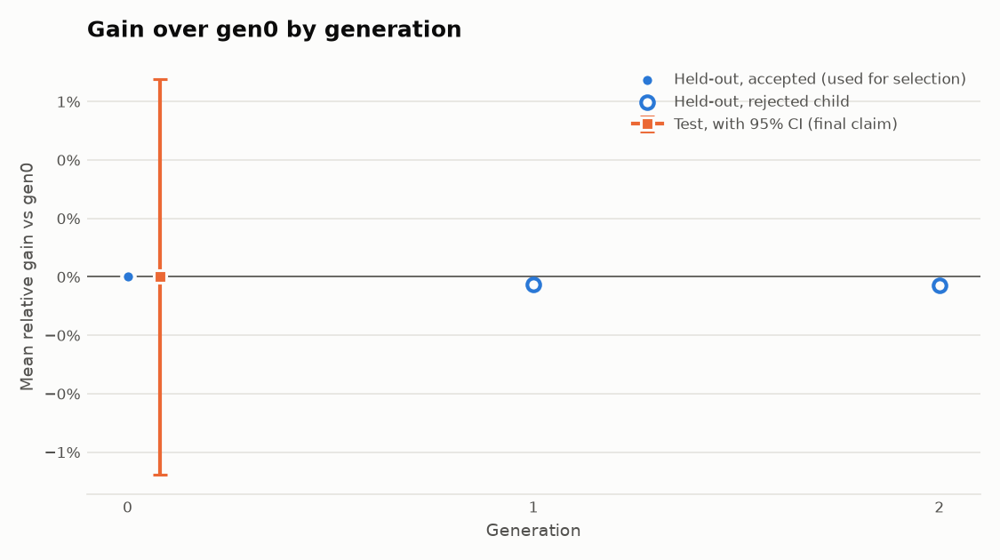
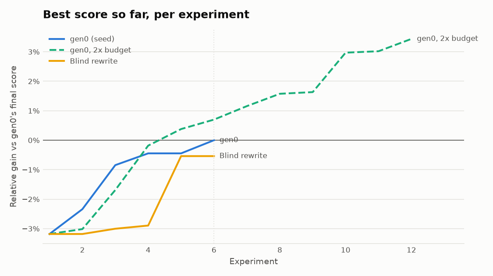

# RSIFlow, first real run

RSIFlow · run `20261117-193714`

Generation loop and 16 of 20 evaluation sessions ran on 3c43d84. The run then hung for 40 minutes on one API request, was stopped, and the evaluation resumed from cached sessions with the client-timeout fix (8ce4c4a), which ran the 4 flow-static sessions. Both workflow children were rejected as ties: on the held-out datasets the baseline stage decided the score. On test, plain Tumble beat the adaptive seed workflow (+2.0%, clear), fixed-order routing was +2.1% (borderline) and 2x budget +3.4% (clear). The per-stage statistics show why: the adaptive router spent 15 of 20 work experiments in preprocess because its min_gain (0.2%) is below the +-0.9% noise floor. Child 1 proposed raising it, but the held-out datasets could not verify the change. DeepSeek-V3.1 via W&B Inference.

- Harness commit: `3c43d84`
- Model: wandb / (provider default)
- Settings: budget 6 · up to 2 generations · 2 test repeats

## Generation loop

Train: heart_cleveland, heart_hungarian · held-out: pima_diabetes, blood_donation · test: liver_ilpd, hospital_readmission

| Gen | Improver | Parent | pima_diabetes (held-out) | blood_donation (held-out) | Decision |
|---|---|---|---|---|---|
| 0 | `gen000-flow-seed` | `—` | 0.884 | 0.728 | seed |
| 1 | `gen001-gen000-child` | `gen000-flow-seed` | 0.884 | 0.727 | rejected |
| 2 | `gen002-gen000-child` | `gen000-flow-seed` | 0.886 | 0.726 | rejected |

**Gen 1 (`gen001-gen000-child`)**: mean relative gain -0.03% (need >= +1.00%), wins/ties/losses 0/2/0 (need more wins than losses) -> REJECT

> I made several changes based on the evidence: (1) Removed 'features' and 'tune' stages because they consistently underperformed (mean relative gains of -0.50% and -3.29% respectively) and wasted experiments. The agent attempted complex feature engineering and tuning that hurt performance. (2) Simplified the 'preprocess' instruction to focus only on missing value indicators and basic handling, as this was the only successful preprocessing approach (both kept experiments used missing indicators). (3) Increased min_gain from 0.002 to 0.005 to prevent wasting experiments on marginal improvements. (4) Reduced plateau_patience from 2 to 1 to move on from unproductive stages faster. (5) Kept 'model' stage but emphasized class balancing for imbalanced datasets, as the evidence shows models without proper class handling performed poorly. (6) Maintained 'ensemble' as a final stage but removed the complex ordering to streamline the workflow.

**Gen 2 (`gen002-gen000-child`)**: mean relative gain -0.04% (need >= +1.00%), wins/ties/losses 0/2/0 (need more wins than losses) -> REJECT

> Based on the evidence: (1) Removed 'features' and 'tune' stages entirely - they showed negative mean gains (-0.50% and -3.29% respectively) and wasted experiments. The agent's attempts at complex feature engineering (ratios, bins, interactions) and hyperparameter tuning consistently hurt performance. (2) Simplified 'preprocess' instruction to focus specifically on missing value indicators and basic handling, as this was the only successful preprocessing approach (both kept experiments used missing indicators). The evidence shows complex preprocessing like outlier handling and feature selection degraded performance. (3) Increased min_gain from 0.002 to 0.005 to prevent wasting experiments on marginal improvements that may not generalize. (4) Reduced plateau_patience from 2 to 1 to move on from unproductive stages faster, given the limited experiment budget. (5) Kept 'model' stage but emphasized class balancing, as the evidence shows models without proper class handling performed poorly. (6) Maintained 'ensemble' as a final stage for potential gains from combining approaches.

## Final evaluation on test datasets
Each contender ran on each test dataset 2 time(s). Scores are mean ± std over repeats.
Gain is relative to gen0's mean score on the same dataset (+ = better), averaged over all runs.
A gain only counts as real if its 95% bootstrap CI excludes 0.

| Contender | Budget | liver_ilpd (roc_auc ↑) | hospital_readmission (roc_auc ↑) | Gain vs gen0 [95% CI] | Verdict | Wasted | Exp. to best | Tokens/run |
|---|---|---|---|---|---|---|---|---|
| gen0 | 6 | 0.7411 ± 0.00025 | 0.6158 ± 0.0099 | +0.0% [-0.8%, +0.8%] | reference | 54% | 4.0 | 404,732 |
| gen0-2x-budget | 12 | 0.7656 ± 0.026 | 0.6379 ± 0.017 | +3.4% [+1.2%, +5.7%] | clear gain | 58% | 10.5 | 829,390 |
| blind-rewrite | 6 | 0.7406 ± 0.006 | 0.6096 ± 0.041 | -0.5% [-4.2%, +2.6%] | within noise | 71% | 2.8 | 559,640 |
| plain-tumble | 6 | 0.7567 ± 0.0093 | 0.6271 ± 0.012 | +2.0% [+0.8%, +3.1%] | clear gain | 33% | 6.0 | 600,960 |
| flow-static | 6 | 0.7695 ± 0.032 | 0.618 ± 0.0075 | +2.1% [-0.1%, +5.3%] | within noise | 42% | 5.2 | 521,341 |

**Noise floor:** gen0 varies by ±0.9% against itself across repeats. Gains smaller than this are not evidence.

### Generation loop

- Children proposed: 2, accepted: 0 (acceptance rate 0%)
- Meta-step tokens (writing children): 6,641

### How to read this

- **genK vs gen0:** did recursion produce a better improver on data it never saw?
- **genK vs gen0-2x-budget:** is recursion better than simply running more experiments?
- **genK vs blind-rewrite:** does learning from run evidence matter, or does any rewrite help?
- **Wasted / Exp. to best:** a better improver should waste fewer experiments and peak sooner.
- **generations.png:** if test gain is far below held-out gain, the loop over-fit its held-out set.





## RSIFlow

Per-stage statistics, routing decisions and every workflow (with the meta-agent's reasons) are in [flow_report.md](flow_report.md).

## Improvers

<details><summary><code>flow-static</code> (generation 0, parent <code>None</code>): workflow</summary>

```json
{
  "stages": {
    "baseline": "Write a robust, simple first train.py: a pipeline with imputation, scaling, one-hot encoding with handle_unknown='ignore', and logistic regression.",
    "fix_errors": "The last script crashed. Read the error, find its cause, and fix only that; keep everything else unchanged.",
    "preprocess": "Improve data handling: missing values (including zeros that really mean missing), encoding of categoricals, scaling, outliers.",
    "model": "Try a different model family suited to this data (e.g. tree ensembles vs linear models).",
    "features": "Engineer new features from domain knowledge: ratios, interactions, bins, missingness indicators.",
    "tune": "Tune the current model's most important hyperparameters, one or two at a time.",
    "ensemble": "Combine the strongest, most different approaches so far (e.g. soft voting of two models)."
  },
  "order": [
    "preprocess",
    "model",
    "features",
    "tune",
    "ensemble"
  ],
  "rules": {
    "adaptive": false,
    "max_fix_attempts": 2,
    "plateau_patience": 2,
    "min_gain": 0.002,
    "stay_on_gain": true
  }
}
```

</details>

<details><summary><code>gen000-flow-seed</code> (generation 0, parent <code>None</code>): workflow</summary>

```json
{
  "stages": {
    "baseline": "Write a robust, simple first train.py: a pipeline with imputation, scaling, one-hot encoding with handle_unknown='ignore', and logistic regression.",
    "fix_errors": "The last script crashed. Read the error, find its cause, and fix only that; keep everything else unchanged.",
    "preprocess": "Improve data handling: missing values (including zeros that really mean missing), encoding of categoricals, scaling, outliers.",
    "model": "Try a different model family suited to this data (e.g. tree ensembles vs linear models).",
    "features": "Engineer new features from domain knowledge: ratios, interactions, bins, missingness indicators.",
    "tune": "Tune the current model's most important hyperparameters, one or two at a time.",
    "ensemble": "Combine the strongest, most different approaches so far (e.g. soft voting of two models)."
  },
  "order": [
    "preprocess",
    "model",
    "features",
    "tune",
    "ensemble"
  ],
  "rules": {
    "adaptive": true,
    "max_fix_attempts": 2,
    "plateau_patience": 2,
    "min_gain": 0.002,
    "stay_on_gain": true
  }
}
```

</details>

<details><summary><code>plain-tumble</code> (generation 0, parent <code>None</code>): research prompt</summary>

```text
You are an autonomous ML research scientist. You've been given a dataset and a
metric to optimize; your job is to write and iteratively improve a training
script, train.py, that models the data as well as possible.
```

</details>

<details><summary><code>blind-rewrite</code> (generation 1, parent <code>gen000-flow-seed</code>): workflow</summary>

```json
{
  "stages": {
    "baseline": "Write a robust, simple first train.py: a pipeline with imputation, scaling, one-hot encoding with handle_unknown='ignore', and logistic regression. Include basic cross-validation and metric tracking.",
    "fix_errors": "The last script crashed. Read the error message carefully, identify the root cause, and fix only that specific issue while preserving all working functionality. Test the fix locally if possible.",
    "data_quality": "Improve data handling: identify and handle missing values (including zeros that might represent missing data), validate data types, check for data leaks, and ensure proper train-test separation.",
    "feature_engineering": "Create new features using domain knowledge: ratios, interactions, polynomial features, bins, missingness indicators, and transformations of existing features. Focus on features likely to have predictive power.",
    "model_selection": "Try different model families appropriate for the problem type (tree ensembles, linear models, neural networks, etc.). Evaluate multiple candidates with cross-validation before selecting the best.",
    "hyperparameter_tuning": "Systematically tune the current model's most important hyperparameters using grid search, random search, or Bayesian optimization. Focus on parameters that most impact performance.",
    "ensemble": "Combine the strongest models from previous stages using stacking, blending, or weighted averaging. Ensure diversity in the ensemble members for maximum benefit."
  },
  "order": [
    "data_quality",
    "feature_engineering",
    "model_selection",
    "hyperparameter_tuning",
    "ensemble"
  ],
  "rules": {
    "adaptive": true,
    "max_fix_attempts": 3,
    "plateau_patience": 3,
    "min_gain": 0.001,
    "stay_on_gain": true
  }
}
```

</details>

<details><summary><code>gen001-gen000-child</code> (generation 1, parent <code>gen000-flow-seed</code>): workflow</summary>

```json
{
  "stages": {
    "baseline": "Write a robust, simple first train.py: a pipeline with imputation, scaling, one-hot encoding with handle_unknown='ignore', and logistic regression.",
    "fix_errors": "The last script crashed. Read the error, find its cause, and fix only that; keep everything else unchanged.",
    "preprocess": "Improve data handling: focus on missing value indicators for high-missing columns, appropriate imputation strategies, and basic scaling. Avoid complex feature engineering or selection in this stage.",
    "model": "Try a different model family suited to this data (e.g., tree ensembles like Random Forest or Gradient Boosting, especially with class_weight='balanced' for imbalanced targets).",
    "ensemble": "Combine the strongest, most different approaches so far (e.g., soft voting of two models)."
  },
  "order": [
    "preprocess",
    "model",
    "ensemble"
  ],
  "rules": {
    "adaptive": true,
    "max_fix_attempts": 2,
    "plateau_patience": 1,
    "min_gain": 0.005,
    "stay_on_gain": true
  }
}
```

</details>

<details><summary><code>gen002-gen000-child</code> (generation 1, parent <code>gen000-flow-seed</code>): workflow</summary>

```json
{
  "stages": {
    "baseline": "Write a robust, simple first train.py: a pipeline with imputation, scaling, one-hot encoding with handle_unknown='ignore', and logistic regression.",
    "fix_errors": "The last script crashed. Read the error, find its cause, and fix only that; keep everything else unchanged.",
    "preprocess": "Focus on missing value handling: add missing indicators for columns with significant missingness, use appropriate imputation (median for numerical, most_frequent for categorical). Avoid complex feature engineering or outlier handling unless clearly beneficial.",
    "model": "Try a different model family suited to this data, but ensure proper class balancing for imbalanced datasets. Consider Random Forest or Gradient Boosting with class_weight='balanced' or similar.",
    "ensemble": "Combine the strongest, most different approaches so far (e.g. soft voting of two models)."
  },
  "order": [
    "preprocess",
    "model",
    "ensemble"
  ],
  "rules": {
    "adaptive": true,
    "max_fix_attempts": 2,
    "plateau_patience": 1,
    "min_gain": 0.005,
    "stay_on_gain": true
  }
}
```

</details>

## Files

- `sessions.csv`: one row per Tumble session
- `lineage.jsonl`: every generation's scores, decision and rationale
- `improvers/`: every improver (prompts, and workflows for RSIFlow)
- `config.json`, `provenance.json`: settings and harness version
- 28 sessions in total
