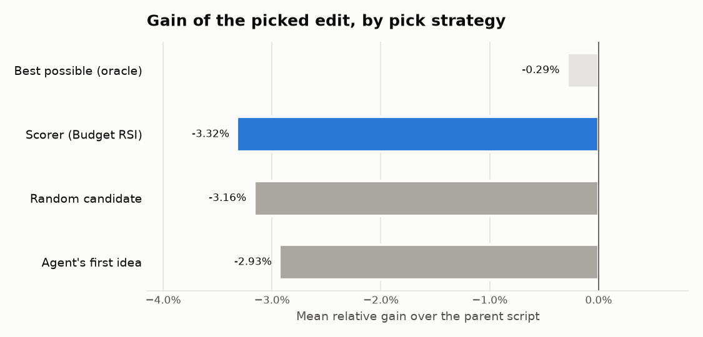
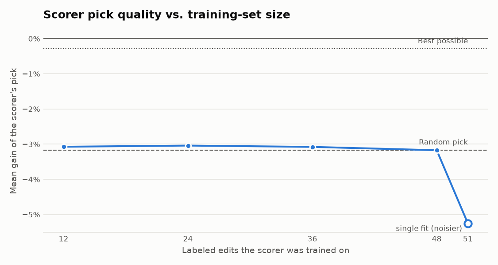

# Budget RSI, first real run

Budget RSI · run `budget-real-1`

Collection on the 4 train + held-out datasets x 2 repeats, budget 4 (1 baseline + 3 candidate rounds), k = 3, every candidate executed: 69 labeled edits in 23 complete rounds. Offline, leave-one-dataset-out: the scorer was no better than a random pick (rank correlation 0.06). Only 11 of 69 edits improved on their parent, and hidden-split noise (+-0.02-0.05 AUC) is larger than most edits' effects. Live: a random pick was a clear loss vs plain Tumble; the scorer's pick was within noise of Tumble and above random on both test datasets (2 repeats: a hint, not evidence). The two charts were regenerated after the run with the labeling fix in e862e6a; the data is unchanged. DeepSeek-V3.1 via W&B Inference.

- Harness commit: `94c1d99` (given at export)
- Model: wandb / (provider default)
- Settings: k 3 candidates · budget 4 · 2 collect / 2 live repeats

k = 3 candidates per round · 4 experiments per session · collection: heart_cleveland, heart_hungarian, pima_diabetes, blood_donation × 2 repeats · test: liver_ilpd, hospital_readmission × 2 repeats

## 1. Offline replay (every candidate was run, so every pick can be scored)

69 labeled edits in 23 rounds. The scorer is always tested on a dataset it was not trained on. Gain = relative improvement of the picked edit over its parent (clipped to ±10%; a crash counts as −10%).

| Pick strategy | Mean gain of the picked edit |
|---|---|
| Best possible (oracle) | -0.29% |
| **Scorer (Budget RSI)** | **-3.32%** |
| Random candidate | -3.16% |
| Agent's first idea | -2.93% |

- Scorer − random: -0.16% [95% CI -1.25%, +0.89%]
- Scorer picked the best candidate in 35% of rounds (random: 33%)
- Scorer's picks crashed in 9% of rounds; 7% of all candidates crashed
- Rank correlation of predicted vs actual gain: 0.06

The parent-score-only ablation from the paper cannot rank candidates here: all candidates in a round share one parent, so it reduces to a random pick.

### Learning curve: does the scorer pick better with more of its own outcomes?

| Labeled edits trained on | Mean gain of scorer's pick |
|---|---|
| 12 | -3.07% |
| 24 | -3.04% |
| 36 | -3.08% |
| 48 | -3.17% |
| 51 | -5.25% |

## 2. What the scorer learned (standardized weights)

Positive = edits with more of this tended to help; negative = tended to hurt.

| Feature | Scorer v1 | Scorer v2 (after live outcomes) |
|---|---|---|
| parent_score | -0.0017 | -0.0110 |
| log_lines_changed | -0.0045 | -0.0045 |
| model_changed | -0.0126 | -0.0127 |
| ensemble_added | +0.0032 | +0.0055 |
| preprocessing_touched | +0.0060 | +0.0070 |
| log_features_added | +0.0105 | +0.0047 |
| log_hyperparams_changed | -0.0054 | -0.0018 |
| search_added | -0.0062 | -0.0117 |
| compiles | +0.0000 | +0.0000 |

v1 trained on 69 edits; v2 on 96 (+27 from live picks)

## 3. Live comparison on untouched test datasets

Same experiment budget for every contender. Gain is relative to plain Tumble's mean score.

| Contender | liver_ilpd AUC | hospital_readmission AUC | Gain vs Tumble [95% CI] | Verdict | Scripts executed / run | Tokens / run |
|---|---|---|---|---|---|---|
| Plain Tumble (1 idea per experiment) | 0.788 ± 0.014 | 0.616 ± 0.007 | -0.00% [-1.04%, +1.04%] | reference | 4.0 | 359,892 |
| Propose 3, run the first | 0.785 ± 0.031 | 0.583 ± 0.000 (1 failed) | -26.53% [-75.79%, +0.46%] | within noise | 4.0 | 464,372 |
| Propose 3, run a random one | 0.758 ± 0.005 | 0.579 ± 0.024 | -4.92% [-7.45%, -3.34%] | clear loss | 4.0 | 768,540 |
| **Propose 3, run the scorer's pick** | 0.765 ± 0.002 | 0.633 ± 0.005 | -0.05% [-2.86%, +2.76%] | within noise | 4.0 | 592,769 |

Noise floor: plain Tumble varies by ±1.2% against itself across repeats.

Reading it: *scorer vs random* isolates whether the learned ranking helps; *random vs first* shows whether the agent's own ordering carries information; *tumble vs first* shows the cost or benefit of asking for 3 ideas at all.

## Files

- `labels.jsonl`: every executed candidate edit -- features, outcome, label, and for live runs which policy picked it
- `analysis/offline.json`: the offline replay, learning curve and v1 weights
- `analysis/scorer_v1.json`, `scorer_v2.json`: the learned scorer before and after its live outcomes
- `live_summary.json`, `sessions.csv`, `config.json`, `provenance.json`
- 96 labeled edits, 24 sessions
